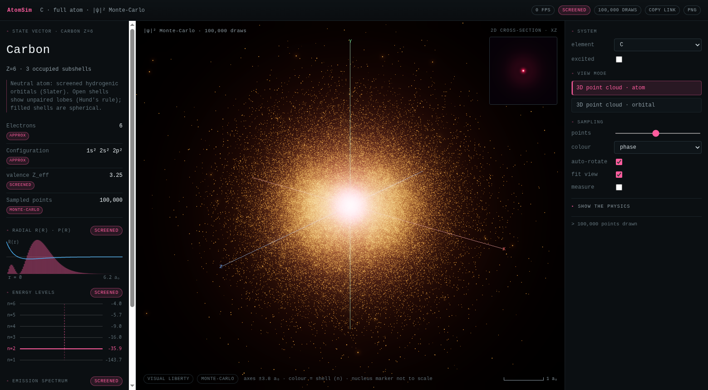

# AtomSim

An interactive 3D simulator of quantum electron clouds: the `|ψ|²` probability
cloud, not the Bohr model's electrons on rings.

Dense points = more likely, sparse = less likely. Colour can show the
wavefunction phase (+ψ / −ψ), the shell, or the density.



## Features

- Real sampled `|ψ|²` for hydrogen-like orbitals (`1s … 7p`) and for neutral
  atoms (all 118 elements, Slater-screened hydrogenic shapes).
- Atom view draws every occupied shell, orbital view a single state. An
  excited-state toggle adds the orbitals above the ground configuration.
- Superpose two orbitals to see where they reinforce and cancel. Time evolution
  is optional; the cloud then oscillates at the beat frequency.
- An orbital gallery gives clickable thumbnails of every orbital for the
  current element.
- Live panels: quantum numbers, energy, `⟨r⟩`, `|L|`, `⟨1/r⟩`, most-probable
  radius, node radii, an R(r)/P(r) plot, an energy-level ladder, an emission
  spectrum, and a 2D cross-section heatmap.
- Colour modes (phase / shell / density), a fit-view toggle, and measurement
  mode, where clicking the cloud collapses it to one point.

## Run it

```bash
npm install
npm run dev        # http://localhost:5173
```

Other scripts: `npm run build`, `npm run preview`, `npm run typecheck`,
`npm test`.

## Honesty note

Hydrogen is exact. Anything with more electrons uses Slater-screened hydrogenic
orbitals, an approximation the UI labels `SCREENED`. Filled shells are
genuinely spherical. The nucleus marker is not to scale by default; the
**true scale** toggle shrinks it to its real size, which shows how empty the
atom is.

See `docs/PHYSICS.md` for the details and `soul.md` for the philosophy.

## For AI agents / contributors

Start with [`AGENTS.md`](AGENTS.md), then [`docs/`](docs/).
